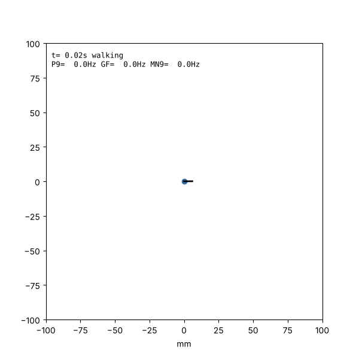
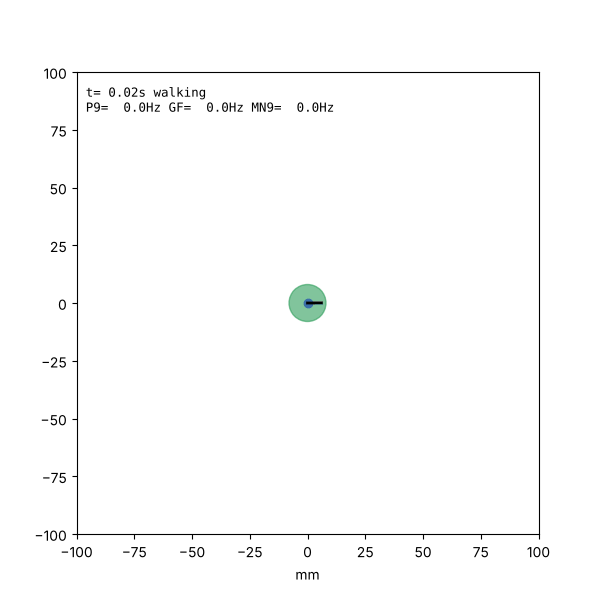

# Fruit-Fly: a closed-loop whole-CNS fly simulation

A spiking simulation of the entire adult male *Drosophila* central nervous system
(brain, optic lobes and ventral nerve cord) wired from the
[MaleCNS v1.0 connectome](https://male-cns.janelia.org) (Janelia/Google, CC-BY).
It covers 165,122 proofread neurons and 24.9 million connections. The simulated
fly walks in a 2D arena: it smells odors, tastes food and sees looming threats,
and its descending neurons steer its body.

```
world ──► sensory neurons ──► 165k-neuron LIF network ──► descending/motor neurons ──► body
 ▲   (ORNs, taste GRNs, LC4/LPLC2)                     (P9, MDN, DNa01/02, Giant Fiber, MN9)  │
 └──────────────────────────────────────────────────────────────────────────────────────────┘
```

| Escape from a looming threat | Taste → proboscis extension → feeding |
|---|---|
|  |  |

## In the browser

**Live page:** https://claude.ai/artifact/KsHLMrs8zWvsWUA4qxfG1G (private until you share it)

`web/` is a static site that runs the whole simulation client-side:

- **Brain:** a JavaScript port of the `realistic` preset (`web/src/brain-engine.js`) runs all
  165,122 neurons and 23.4M connections in a Web Worker. It updates a neuron only while it
  could reach threshold; quiet neurons are advanced in closed form when input arrives. It
  matches the Python engine (`node web/tools/check_engine.mjs`). The connectome is a
  one-time 46 MB download, fetched one part at a time with automatic retries.
- **Spontaneous activity:** with the switch on (default), about 11,800 sensory neurons fire
  at low background rates, as real ones do (`flysim/interface.py: SPONTANEOUS_HZ`), so the
  brain is active at rest and the fly walks, pauses, backs up and takes off on its own.
  This roughly halves simulation speed; the panel shows the speed relative to real time.
- **Behavior from motor neurons:** walking speed and turning come from the leg motor-neuron
  pools of the ventral nerve cord (500 neurons, by side), voluntary flight from the indirect
  flight-muscle motor neurons (DLMn, DVMn) and steering from the wing motor neurons. P9 and
  MDN still add forward and backward walking, MN9 feeding, and the Giant Fiber escape.
- **Body:** the [FlyBody](https://github.com/TuragaLab/flybody) model (Vaxenburg et al.
  2025, *Nature*; 272k triangles, 99 joints), rigged by
  [flygym](https://github.com/NeLy-EPFL/flygym). Legs replay single-step trajectories
  recorded from a real walking fly in a tripod gait. Stepping frequency follows walking
  speed, and stride length on each side follows turning. Wings, halteres, proboscis and
  antennae are posed from the same model and behavioral state.
- **Skin (switchable):** "Realistic" paints the FlyBody mesh from *Drosophila* anatomy:
  a golden-brown thorax with faint scutal stripes, the male abdomen's tan tergites with dark
  posterior bands and wholly dark A5–A6, pale sternites and legs with darker tarsi, about
  780 hexagonal lens facets per eye with the dark pseudopupil, a fine-grained waxy cuticle
  and clear iridescent wings. "Plain" restores FlyBody's flat colours. Folded wings rest
  on top of the abdomen, right over left (solved so they clear it by at least 15 µm).
- **World:** a 200 mm arena with a 50 mm glass wall. The floor switch picks the lab
  arena (filter paper, the default) or grass and small weeds (fine turf, clover, dandelion
  rosettes, seedlings, and two four-leaf clovers among the three-leaf ones) at true scale for a 2.5 mm fly. On grass the fly walks on top of
  leaves and the matted turf, tilted to the surface, and tastes food only when it is down
  on the ground. It stands on its six feet: it stays on a leaf while at least two feet are
  on it (so it walks across gaps between leaflets without bobbing), and changes level with a
  short wing-assisted hop aimed at where its feet will land, then commits to that surface for
  a moment; in flight it holds altitude over plants
  and settles onto whatever is below as it lands.
  Grass covers the whole arena floor (blades are placed on the GPU in rings that coarsen
  with distance). Only blades under the fly's body and legs are pressed down,
  and leaves are solid: grass stays under a leaf lying on the turf.
  Plants have detailed skins drawn per pixel: grass blades with parallel veins, a folded
  midrib, pale sheaths and yellowing or dry tips; clover leaflets with fine side veins, a
  vein network and white clover's pale chevron; dandelion leaves with a broad pale midrib
  flushed red-purple at the base; paler undersides and raised or sunken veins on all.
- **Grooming:** touching the head bristles (a poke, a raindrop, a snowflake) drives the DNg12
  descending neurons in the connectome (to ~10 Hz; near 0 at rest), and while they fire the
  fly stops and cleans its head: front-leg sweeps over the eyes alternating with leg rubbing
  (Guo et al. 2022). The leg poses were solved by forward kinematics so the tarsi reach the
  eye, the underside of the head and each other.
- **Panels:** every control and readout panel folds away (each section, or a whole side),
  and the layout is remembered.
- **Weather:** rain or snow at five intensities each, with real fly-scale physics. Rain
  uses measured drop sizes (Marshall–Palmer) and terminal fall speeds (up to 9 m/s); a 2 mm
  drop weighs four times the fly. Drops land on leaves, turf, food or the fly, splash
  crown droplets, bead on leaves, and knock grass and leaves down, which then spring back;
  a fly under a leaf is sheltered. Snowflakes (Locatelli & Hobbs masses and speeds) drift
  down, settle on everything including the fly, and melt. A hit on the fly pushes it,
  can force it down in flight, and fires the touch neurons where it landed; a leaf the
  fly stands on bobs and its legs feel it. Rain drives the moist-air receptor neurons
  (HRN_VP5) and snow the cold receptors (TRN_VP3). Gusts from the wind tool slant both.
- **What you can do:** drop food, place odor sources (vinegar, CO₂, geosmin), launch
  looming threats, **poke** a body part (head, back, legs or abdomen: that side's touch
  neurons fire), **blow wind** from any direction (Johnston's-organ wind neurons, stronger
  on the windward antenna), and use **optogenetics** to drive any of the 11,751 named cell
  types (for example MDN to walk backward, DNp09 to run, DNp01 to escape). The panels show
  motor and descending-neuron rates, sensory input, and a dorsal map of the whole CNS that
  flashes on every spike.

All assets are in the repository, so the site runs straight from a download or clone:
`python -m http.server -d web 8000`, then open http://localhost:8000.

To rebuild the assets:

```bash
PYTHONPATH=. python web/tools/export_brain.py          # connectome -> web/assets/brain*.png
pip install flygym                                     # only for re-exporting the body
python web/tools/export_body.py --flybody-repo ../flybody  # -> web/assets/fly.{json,png}
python -m http.server -d web 8000                      # open http://localhost:8000
```

Binary data is stored as grayscale PNGs (`web/tools/pngpack.py`) because static hosts that
only serve web media types still serve PNG. The browser inflates the pixel rows directly,
so the bytes are exact.

## On your wrist: Feed the Fly

[`watch/`](watch) is a Tamagotchi-style Wear OS game (built for the Galaxy Watch Ultra)
where a 15k-neuron subcircuit of the same connectome decides whether your fly eats and
when it flees. See [watch/README.md](watch/README.md) to install it.

## Quick start

```bash
pip install -r requirements.txt
# Google Cloud CLI (gsutil) is needed once to fetch ~570 MB of connectome data into data/
python -m flysim download
python -m flysim escape --seconds 3 --gif     # looming disc -> Giant Fiber -> takeoff
python -m flysim feed --seconds 3 --gif       # standing on food -> MN9 -> feeding bout
python -m flysim forage --seconds 15          # vinegar plume + food patch
python -m flysim explore --seconds 5
python experiments/validate.py                # circuit checks -> results/validation.md
pytest tests
```

Each run writes `results/<scenario>-<preset>.{csv,png[,gif]}`: the trajectory,
sensory input, motor-neuron rates and a spike raster. The simulation runs about
5× slower than real time on 4 CPU cores. The first run compiles a cached matrix
in `data/`, which takes about 25 s.

## How it works

**Connectome** (`flysim/data.py`). The loader downloads the flat-connectome
feather files from `gs://flyem-male-cns/v1.0/connectome-data/flat-connectome/`
and keeps the `Traced` neurons. Each connection's synapse count is signed by
the presynaptic neuron's predicted transmitter: acetylcholine is excitatory;
GABA, glutamate (GluCl) and histamine are inhibitory; monoamines have no fast effect.

**Neurons** (`flysim/model.py`). The network uses the leaky integrate-and-fire
model and parameters of
[Shiu et al. 2024, *Nature* 634:210](https://www.nature.com/articles/s41586-024-07763-9).
That paper showed this model, wired only from a connectome, predicts real
sensorimotor circuits. The parameters are v_rest = −52 mV, threshold −45 mV,
τ_m = 20 ms, τ_syn = 5 ms, 0.275 mV per synapse, 1.8 ms delay and 2.2 ms
refractory period. The model is compiled with numba, with an event-driven
spike propagation step.

**Presets.** Running the published model unchanged on the full male CNS
(`--preset shiu2024`) fails: within ~300 ms of almost any olfactory or taste
input, 10–20k neurons lock into self-sustaining activity that never stops (see
`results/validation.md`). The default `realistic` preset adds five
biologically motivated changes:

1. **Short-term synaptic depression** (U = 0.2, τ_rec = 500 ms). Fly synapses
   depress strongly (e.g. ORN→PN, Kazama & Wilson 2008). The first spike after
   rest has the full Shiu weight, so onset responses are unchanged.
2. **No KC→KC synapses.** These ~1.15M axo-axonal synapses in the mushroom body
   lobes otherwise ignite all ~4,000 Kenyon cells.
3. **No synapses onto sensory neurons.** These sit on axon terminals, and sensory
   spikes start in the periphery.
4. **"Unclear" transmitter neurons get zero sign** instead of being assumed excitatory.
5. **Spike-frequency adaptation** (1 mV per spike, τ = 200 ms). Without it the antennal
   lobe's excitatory local neurons (lLN1_bc) lock into ~250 Hz self-sustained firing
   whenever there is any smell input or background activity.

**Senses and motors** (`flysim/interface.py`). These are hand-built links,
each with a literature citation in the code:

| world | neurons driven |
|---|---|
| odor at each antenna (vinegar / CO₂ / geosmin) | ORNs of the matching glomeruli, by antenna of origin |
| standing on food | labellar/pharyngeal taste neurons that drive MN9 |
| looming disc, per eye | LC4 and LPLC2 |

| neurons read out | behavior |
|---|---|
| DNp09 (P9) | forward walking speed |
| MDN | backward walking |
| DNa02, DNa01 (left − right) | turning |
| DNp01 (Giant Fiber) | takeoff away from the threat |
| MN9 | proboscis extension → feeding bout |

**Body** (`flysim/body.py`). The body is kinematic, with realistic speeds. When
no descending commands arrive, the fly explores with a slow random walk. This
stands in for the VNC's own walking rhythm, which the model does not generate.

## What the model reproduces, and what it does not

Validated (`results/validation.md`, `realistic` preset):

- **Looming escape.** LC4 or LPLC2 input alone drives the Giant Fiber at 120–140 Hz
  (both together about 210 Hz), which in turn drives the flight motor neurons (DLMn).
  Proboscis and walking neurons stay silent. In the Python closed loop the fly takes off
  about 0.2–0.3 s before a simulated collision.
- **Feeding.** A subset of taste-neuron types (LB3b–d, LB4a, PhG1a–c) drives MN9.
  The release does not label which taste types are sugar-sensing, so these
  types were selected because they drive MN9 in this model.
- **Stability.** For every input tested, activity stops within 300 ms of the stimulus
  ending. (Before adaptation was added, vinegar left about 200 antennal-lobe neurons
  firing.)

Limits to keep in mind:

- **Odor tracking does not emerge.** Vinegar ORNs drive bursts in MDN, DNa01/02
  and other descending neurons, but nearly symmetrically. The fly does not reliably
  steer up a gradient. Real chemotaxis likely depends on things a connectome
  doesn't contain: graded (non-spiking) neurons, tonic background activity,
  neuromodulation and learned synaptic strengths.
- **MN9 responds on the left only.** In this release, MN9_R receives far fewer
  synapses from its main premotor input (GNG120: 25 vs 418). This is likely
  incomplete reconstruction, and the simulation inherits it.
- **No vision below LC4/LPLC2.** The photoreceptor-to-lamina path is
  histaminergic and graded, which a spiking model at rest cannot represent, so
  looming is injected at the visual projection neurons.
- **Fast synapses only.** The model has no gap junctions, neuromodulation or plasticity.
  One visible consequence: the Giant Fiber's synapse onto the jump motor neuron (TTMn) is
  mostly electrical, so in the model TTMn barely responds (5–11 Hz) while the Giant Fiber
  fires at 300+ Hz. Escape is therefore read from the Giant Fiber itself.
- **Spontaneous rates are partly assumed.** Smell-receptor rates follow published ranges;
  the others are low guesses, and the behavior thresholds were set from a minute of
  simulated spontaneous activity (in `web/src/world.js`).

To change any mapping, edit the tables in `flysim/interface.py`. To change the
model, pass parameters to `make_brain`:

```python
from flysim import data, model
c = data.load()
brain = model.make_brain(c, "realistic", stp_u=0.3)
brain.set_rates(c.select(type="LC4"), 150.0)
counts = brain.run(200.0)                    # spikes per neuron in 200 ms
print(model.rate_hz(counts, c.select(type="DNp01"), 200.0))
```

## Credits

This project is built on other people's work. Full citations, licenses and details are in
[CREDITS.md](CREDITS.md); please cite those works, not this repository.

| What | Who | License |
|---|---|---|
| **Connectome** (neurons, connections, transmitter predictions, annotations) | MaleCNS v1.0: HHMI Janelia FlyEM, Google Research, Cambridge Connectomics Group / MRC LMB and consortium. Berg *et al.*, *Cell* (2026). [male-cns.janelia.org](https://male-cns.janelia.org) | CC-BY 4.0 |
| **Neuron model** (LIF equations and parameters) | Shiu, Sterne *et al.*, "A *Drosophila* computational brain model reveals sensorimotor processing", *Nature* 634 (2024) | paper / [code](https://github.com/philshiu/Drosophila_brain_model) |
| **3D fly model** (meshes, skeleton, materials) | FlyBody: Vaxenburg, Siwanowicz *et al.*, "Whole-body physics simulation of fruit fly locomotion", *Nature* 643 (2025). [TuragaLab/flybody](https://github.com/TuragaLab/flybody) | Apache 2.0 |
| **Rigging and recorded leg movements** | NeuroMechFly / flygym (NeLy lab, EPFL): Wang-Chen *et al.*, *Nature Methods* 21 (2024); Lobato-Rios *et al.*, *Nature Methods* 19 (2022). [NeLy-EPFL/flygym](https://github.com/NeLy-EPFL/flygym) | Apache 2.0 |
| **Sensory and motor neuron roles** | Studies cited in [CREDITS.md](CREDITS.md) and next to each entry in `flysim/interface.py` | — |
| **Rendering** | three.js authors | MIT |
| **Fonts** | Newsreader (Production Type), Hanken Grotesk (Hanken Design Co.), JetBrains Mono (JetBrains) | SIL OFL |

Copies of the upstream Apache 2.0 licenses are in [`licenses/`](licenses). The website
shows the same credits in its **Credits** panel.
