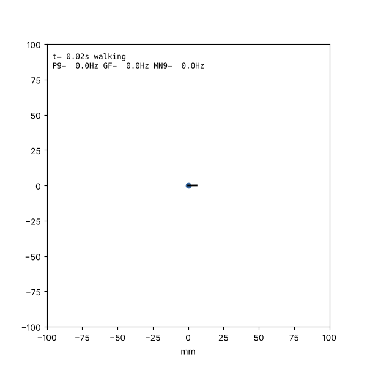
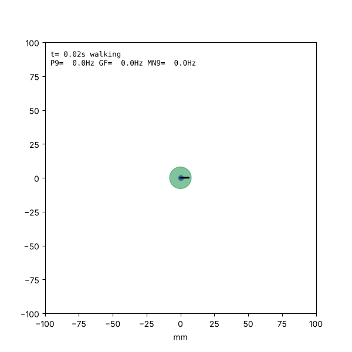

# Fruit-Fly: a closed-loop whole-CNS fly simulation

A spiking simulation of the entire adult male *Drosophila* central nervous system
(brain, optic lobes and ventral nerve cord) wired from the
[MaleCNS v1.0 connectome](https://male-cns.janelia.org) (Janelia/Google, CC-BY).
It covers 165,122 proofread neurons and 24.9 million connections. The simulated
fly walks in a 2D arena: it smells odors, tastes food and sees looming threats,
and its descending neurons steer its body.

```
world ──► sensory neurons ──► 165k-neuron LIF network ──► descending/motor neurons ──► body
 ▲   (ORNs, taste GRNs, LC4/LPLC2)                     (P9, MDN, DNa01/02, Giant Fiber, MN9)  │
 └──────────────────────────────────────────────────────────────────────────────────────────┘
```

| Escape from a looming threat | Taste → proboscis extension → feeding |
|---|---|
|  |  |

## In the browser

**Live page:** https://claude.ai/artifact/KsHLMrs8zWvsWUA4qxfG1G (private until you share it)

`web/` is a static site that runs the whole simulation client-side:

- **Brain:** a JavaScript port of the `realistic` preset (`web/src/brain-engine.js`) runs all
  165,122 neurons and 23.4M connections in a Web Worker. It updates a neuron only while it
  could reach threshold; quiet neurons are advanced in closed form when input arrives. It
  matches the Python engine (`node web/tools/check_engine.mjs`). The connectome is a
  one-time 46 MB download, fetched one part at a time with automatic retries. The browser
  keeps it (Cache Storage), so later visits load it from the device; a new export is
  downloaded again and replaces the old copy.
- **Neuron model switch (Simulation panel):** *Standard* is the model above. *Detailed*
  adds two things the standard model leaves out, using wiring it otherwise discards
  (a further 450 KB download): the 131 octopamine neurons act as a slow arousal signal on
  their 200,000 targets; dopamine teaches the mushroom body (a Kenyon cell's synapses onto
  an output neuron weaken when it fires while that compartment's dopamine neurons are
  active, and recover over minutes). Electrical junctions are accepted only from a separate
  evidence-backed dataset; none are currently bundled, so no Giant Fiber gap junctions are
  simulated by default. The Status panel counts
  the weakened synapses. It runs about 30–40% slower. See "Detailed model" below.
- **Spontaneous activity:** with the switch on (default), about 11,800 sensory neurons fire
  at low background rates, as real ones do (`flysim/interface.py: SPONTANEOUS_HZ`), so the
  brain is active at rest and the fly walks, pauses, backs up and takes off on its own.
  This roughly halves simulation speed; the panel shows the speed relative to real time.
- **Behavior from motor neurons:** walking speed and turning come from the leg motor-neuron
  pools of the ventral nerve cord (500 neurons, by side), voluntary flight from the indirect
  flight-muscle motor neurons (DLMn, DVMn) and steering from the wing motor neurons. P9 and
  MDN still add forward and backward walking, MN9 feeding, and the Giant Fiber escape.
- **Body:** the [FlyBody](https://github.com/TuragaLab/flybody) model (Vaxenburg et al.
  2025, *Nature*; 272k triangles, 99 joints), rigged by
  [flygym](https://github.com/NeLy-EPFL/flygym). Legs replay single-step trajectories
  recorded from a real walking fly in a tripod gait. Stepping frequency follows walking
  speed, and stride length on each side follows turning. Wings, halteres, proboscis and
  antennae are posed from the same model and behavioral state.
- **Skin (switchable):** "Realistic" paints the FlyBody mesh from *Drosophila* anatomy:
  a golden-brown thorax with faint scutal stripes, the male abdomen's tan tergites with dark
  posterior bands and wholly dark A5–A6, pale sternites and legs with darker tarsi, about
  780 hexagonal lens facets per eye with the dark pseudopupil, a fine-grained waxy cuticle
  and clear iridescent wings. "Plain" restores FlyBody's flat colours. Folded wings rest
  on top of the abdomen, right over left (solved so they clear it by at least 15 µm).
- **World:** a 200 mm arena with a 50 mm glass wall. The floor switch picks the lab
  arena (filter paper, the default) or grass and small weeds (fine turf, clover, dandelion
  rosettes, seedlings, and two four-leaf clovers among the three-leaf ones, in a new random spot on every visit) at true scale for a 2.5 mm fly. On grass the fly walks on top of
  leaves and the matted turf, tilted to the surface, and tastes food only when it is down
  on the ground. It stands on its six feet: it stays on a leaf while at least two feet are
  on it (so it walks across gaps between leaflets without bobbing), and changes level with a
  short wing-assisted hop aimed at where its feet will land, then commits to that surface for
  a moment; in flight it holds altitude over plants
  and settles onto whatever is below as it lands.
  Grass covers the whole arena floor (blades are placed on the GPU in rings that coarsen
  with distance). Only blades under the fly's body and legs are pressed down,
  and leaves are solid: grass stays under a leaf lying on the turf.
  Plants have detailed skins drawn per pixel: grass blades with parallel veins, a folded
  midrib, pale sheaths and yellowing or dry tips; clover leaflets with fine side veins, a
  vein network and white clover's pale chevron; dandelion leaves with a broad pale midrib
  flushed red-purple at the base; paler undersides and raised or sunken veins on all.
  The grass floor is also a patch of forest floor (`web/src/forest.js`, models in
  `web/assets/env`): stones from pebbles to rocks, moss tufts around their bases, and young
  bracken and lady ferns toward the wall. Stones and moss are solid ground: the fly walks
  and hops up onto them, frogs sit on them, rain lands on them and grass stays beneath.
  The stone set's texture maps were not supplied, so the stones have a procedural surface.
  In the middle is a pond 28 cm across (the arena is 90 cm across), its basin cut from the
  ground tile it came with and set into the floor, with its own water (`web/src/water.js`):
  a mirrored reflection pass and a refraction pass with depth, so the surface reflects the
  banks, sky, frogs and fly and shows the bed through it, bent by drifting ripples and by
  rings wherever the fly walks on the water, raindrops land or frogs splash, darker and
  greener with depth and fading into the wet bank at the shoreline, with glints of the sun.
  The bed has silt, algae in the shallows and moving caustics; pondweed sways under the
  water, duckweed floats near the banks, shoreline stones sit half in the water, and the
  banks, stones and grass are wet at the waterline. There is haze only in the rain.
  The pond model draws its cattails and water lilies as flat painted cards; those are
  replaced by modelled ones (`web/src/pondplants.js`) in the same places: cattails with
  arching, twisting, folded leaves swaying in the wind and velvety brown heads on their
  stalks, and lily pads with their notch, upturned rim, veins, waxy sheen and stalks down
  to the bed. The rushes are still the model's cards.
  On a computer the scenery uses its models at full resolution: the pond with its original
  2048-pixel textures (`web/assets/env/hd`), the lawn mixed from all 17 clumps of the grass
  model with its 2048-pixel colour, normal and roughness maps, and every stone of the stone
  set. The lawn is one even carpet over the whole arena, the same density everywhere
  rather than finer round the fly (one clump per 2.2 mm square on High, 2.8 on Medium,
  3.4 on Low, each drawn with part of its blades); a phone gets 1024-pixel textures.
  A Graphics setting (Low, Medium, High: the Graphics button in the phone game, or
  Simulation: Graphics) changes this on any device and is remembered there. Low is a
  phone's default; Medium keeps more of the lawn's blades and adds sharper water
  (a reflection every frame at 0.6 resolution) and 4096-pixel shadows; High is the
  computer's full scene (on a phone at up to 2.5x pixel density, with the standard pond).
- **Frogs in the pond:** the Montane Brown Frog swims: frog kicks with both hind legs, a
  glide with them trailing, forelegs back along its sides, low in the water with only its
  eyes and back out, and it floats with its legs hanging spread when it stops. It goes into
  the pond now and then, hunts flies on the water or on the bank from there, and leaps out
  onto the bank. The Japanese Toad keeps out of the water and stops at the edge.
- **Mouths and tongues:** the frog models have no jaw, so one is rigged when they load: a
  jaw bone hinged behind the eyes carries the lower lip, chin and throat skin, and opening
  it parts the lips and shows the inside of the mouth. To strike, the mouth gapes, the
  broad, wet tongue (rooted at the front of the lower jaw) flips up and over onto the fly,
  comes back with it stuck to its pad, and only then does the mouth shut and the frog
  swallow, its eyes pressing down.
- **Camera on a frog:** the camera can follow the fly, the frog or the toad (Simulation:
  "Camera on", or the Camera bar at the bottom of the screen; in the phone game, the Camera
  button at the top cycles through them). It
  moves with the frog as it hops and swims; choosing a hidden frog shows it.
- **Grooming:** touching the head bristles (a poke, a raindrop, a snowflake) drives the DNg12
  descending neurons in the connectome (to ~10 Hz; near 0 at rest), and while they fire the
  fly stops and cleans its head: front-leg sweeps over the eyes alternating with leg rubbing
  (Guo et al. 2022). The leg poses were solved by forward kinematics so the tarsi reach the
  eye, the underside of the head and each other.
- **Defecation:** what the fly drinks fills its gut and, after passing through (compressed to
  about a minute; in a real fly it takes on the order of an hour), leaves as small round
  droplets: the fly stops, curls the tip of its abdomen down and leaves a glossy drop on the
  ground (Cognigni et al. 2011; Wayland et al. 2014). An empty gut still passes one now and
  then. This is body-level physiology, not driven by the connectome.
- **More command neurons:** the body also reads out the non-Giant-Fiber escape neurons
  (DNp02/DNp04/DNp11: long-mode takeoffs with the wings raised first, forward or backward),
  the landing neurons DNp07/DNp10 (legs extend, the fly comes down), DNg02 (wing power in
  flight), DNb01 (flight saccades) and pIP10/pMP2 (courtship song: one wing out and
  vibrating). Looming drives the escape neurons by itself; the rest can be driven from the
  optogenetics presets, since nothing in the arena excites them (the landing neurons'
  visual responses need the flight state, which the model does not include).
- **Panels:** every control and readout panel folds away (each section, or a whole side),
  and the layout is remembered.
- **Weather:** rain or snow at five intensities each, with real fly-scale physics. Rain
  uses measured drop sizes (Marshall–Palmer) and terminal fall speeds (up to 9 m/s); a 2 mm
  drop weighs four times the fly. Drops land on leaves, turf, food or the fly, splash
  crown droplets, bead on leaves, and knock grass and leaves down, which then spring back;
  a fly under a leaf is sheltered. Snowflakes (Locatelli & Hobbs masses and speeds) drift
  down, settle on everything including the fly, and melt. A hit on the fly pushes it,
  can force it down in flight, and fires the touch neurons where it landed; a leaf the
  fly stands on bobs and its legs feel it. Rain drives the moist-air receptor neurons
  (HRN_VP5) and snow the cold receptors (TRN_VP3). Gusts from the wind tool slant both.
- **Sky:** outdoors on the grass arena, a physically based daylight sky (Preetham scattering)
  with drifting clouds lit from the sun's side. Rain and snow thicken and darken the
  clouds and haze the horizon. In rain, with the sun behind you, a rainbow appears where
  raindrop optics put it: the primary bow 40.5–42.3° from the antisolar point with red
  outside, the fainter secondary at 50–53.5° with its colors reversed, a brighter sky
  inside the primary and Alexander's dark band between them. The sun sits 32° up, low
  enough for the bow to clear the horizon; a downpour's clouds hide most of it.
- **Sound:** synthesized live from what the simulation does (no recordings), after your
  first click: the wingbeat buzz in flight (~210 Hz, rising with wing power), the pulse
  song (220 Hz pulses every 35 ms) when it sings, rubbing while it grooms, rain hiss with
  plinks of nearby drops, snowy wind, and a whoosh for gusts and looming threats. It is
  louder the closer the camera is to the fly. Mute or set the volume in the Scene panel.
- **What you can do:** drop food, place odor sources (vinegar, CO₂, geosmin), launch
  looming threats, **poke** a body part (head, back, legs or abdomen: that side's touch
  neurons fire), **blow wind** from any direction (Johnston's-organ wind neurons, stronger
  on the windward antenna), and use **optogenetics** to drive any of the 11,751 named cell
  types (for example MDN to walk backward, DNp09 to run, DNp01 to escape). The panels show
  motor and descending-neuron rates, sensory input, and a dorsal map of the whole CNS that
  flashes on every spike.

**Game mode** (`index.html?game`): the same 3D fly, grass arena and brain, kept as a pet. You
name it first (tap the name later to rename it). Its
food, energy and mood change over hours (also while the page is closed, saved in the
browser), it sleeps from 22:00 to 07:00, walks to the sugar you drop and drinks if its
taste neurons drive MN9 (they respond more the hungrier it is), and leaves droppings that
sour its mood until you clean them up. **Lab** brings back the science panels.

**On a Windows PC:** download the `fruit-fly-pc` artifact from the latest "Fruit Fly for
Windows" Actions run, unzip it and double-click `Install.cmd`: it installs the game to
`%LOCALAPPDATA%\FruitFly` and puts a Fruit Fly icon on the desktop. The icon starts a small
local server (`pc/FruitFly.ps1`, plain PowerShell) and opens the game in its own window,
offline, at high quality (on a computer it renders the pond's reflections and refraction at
full resolution, with denser grass and sharper shadows; `?quality=low` lightens it).

All assets are in the repository, so the site runs straight from a download or clone:
`python -m http.server -d web 8000`, then open http://localhost:8000.

To rebuild the assets:

```bash
PYTHONPATH=. python web/tools/export_brain.py          # connectome -> web/assets/brain*.png
PYTHONPATH=. python web/tools/export_detailed.py       # detailed model wiring -> web/assets/brain-detail.png
pip install flygym                                     # only for re-exporting the body
python web/tools/export_body.py --flybody-repo ../flybody  # -> web/assets/fly.{json,png}
python -m http.server -d web 8000                      # open http://localhost:8000
```

Binary data is stored as grayscale PNGs (`web/tools/pngpack.py`) because static hosts that
only serve web media types still serve PNG. The browser inflates the pixel rows directly,
so the bytes are exact.

## On your wrist: Feed the Fly

[`watch/`](watch) is a Tamagotchi-style Wear OS game (built for the Galaxy Watch Ultra)
where a 15k-neuron subcircuit of the same connectome decides whether your fly eats and
when it flees. There is also a phone version, which is the website's game mode with the full
3D fly and whole brain, offline. See [watch/README.md](watch/README.md) to install them.

## Quick start

```bash
pip install -r requirements.txt
# Google Cloud CLI (gsutil) is needed once to fetch ~570 MB of connectome data into data/
python -m flysim download
python -m flysim escape --seconds 3 --gif     # looming disc -> Giant Fiber -> takeoff
python -m flysim feed --seconds 3 --gif       # standing on food -> MN9 -> feeding bout
python -m flysim forage --seconds 15          # vinegar plume + food patch
python -m flysim explore --seconds 5
python experiments/validate.py                # circuit checks -> results/validation.md
pytest tests
```

Each run writes `results/<scenario>-<preset>.{csv,png[,gif]}`: the trajectory,
sensory input, motor-neuron rates and a spike raster. The simulation runs about
5× slower than real time on 4 CPU cores. The first run compiles a cached matrix
in `data/`, which takes about 25 s.

## How it works

**Connectome** (`flysim/data.py`). The loader downloads the flat-connectome
feather files from `gs://flyem-male-cns/v1.0/connectome-data/flat-connectome/`
and keeps the `Traced` neurons. Each connection's synapse count is signed by
the presynaptic neuron's predicted transmitter: acetylcholine is excitatory;
GABA, glutamate (GluCl) and histamine are inhibitory; monoamines have no fast effect.

**Neurons** (`flysim/model.py`). The network uses the leaky integrate-and-fire
model and parameters of
[Shiu et al. 2024, *Nature* 634:210](https://www.nature.com/articles/s41586-024-07763-9).
That paper showed this model, wired only from a connectome, predicts real
sensorimotor circuits. The parameters are v_rest = −52 mV, threshold −45 mV,
τ_m = 20 ms, τ_syn = 5 ms, 0.275 mV per synapse, 1.8 ms delay and 2.2 ms
refractory period. The model is compiled with numba, with an event-driven
spike propagation step.

**Presets.** Running the published model unchanged on the full male CNS
(`--preset shiu2024`) fails: within ~300 ms of almost any olfactory or taste
input, 10–20k neurons lock into self-sustaining activity that never stops (see
`results/validation.md`). The default `realistic` preset adds five
biologically motivated changes:

1. **Short-term synaptic depression** (U = 0.2, τ_rec = 500 ms). Fly synapses
   depress strongly (e.g. ORN→PN, Kazama & Wilson 2008). The first spike after
   rest has the full Shiu weight, so onset responses are unchanged.
2. **No KC→KC synapses.** These ~1.15M axo-axonal synapses in the mushroom body
   lobes otherwise ignite all ~4,000 Kenyon cells.
3. **No synapses onto sensory neurons.** These sit on axon terminals, and sensory
   spikes start in the periphery.
4. **"Unclear" transmitter neurons get zero sign** instead of being assumed excitatory.
5. **Spike-frequency adaptation** (1 mV per spike, τ = 200 ms). Without it the antennal
   lobe's excitatory local neurons (lLN1_bc) lock into ~250 Hz self-sustained firing
   whenever there is any smell input or background activity.

**Senses and motors** (`flysim/interface.py`). These are hand-built links,
each with a literature citation in the code:

| world | neurons driven |
|---|---|
| odor at each antenna (vinegar / CO₂ / geosmin) | ORNs of the matching glomeruli, by antenna of origin |
| standing on food | labellar/pharyngeal taste neurons that drive MN9 |
| looming disc, per eye | LC4 and LPLC2 |

| neurons read out | behavior |
|---|---|
| DNp09 (P9) | forward walking speed |
| MDN | backward walking |
| DNa02, DNa01 (left − right) | turning |
| DNp01 (Giant Fiber) | takeoff away from the threat |
| MN9 | proboscis extension → feeding bout |

**Body** (`flysim/body.py`). The body is kinematic, with realistic speeds. When
no descending commands arrive, the fly explores with a slow random walk. This
stands in for the VNC's own walking rhythm, which the model does not generate.

## What the model reproduces, and what it does not

Validated (`results/validation.md`, `realistic` preset):

- **Looming escape.** LC4 or LPLC2 input alone drives the Giant Fiber at 120–140 Hz
  (both together about 210 Hz), which in turn drives the flight motor neurons (DLMn).
  Proboscis and walking neurons stay silent. In the Python closed loop the fly takes off
  about 0.2–0.3 s before a simulated collision.
- **Feeding.** A subset of taste-neuron types (LB3b–d, LB4a, PhG1a–c) drives MN9.
  The release does not label which taste types are sugar-sensing, so these
  types were selected because they drive MN9 in this model.
- **Stability.** For every input tested, activity stops within 300 ms of the stimulus
  ending. (Before adaptation was added, vinegar left about 200 antennal-lobe neurons
  firing.)

Limits to keep in mind:

- **Odor tracking does not emerge.** Vinegar ORNs drive bursts in MDN, DNa01/02
  and other descending neurons, but nearly symmetrically. The fly does not reliably
  steer up a gradient. Real chemotaxis likely depends on things a connectome
  doesn't contain: graded (non-spiking) neurons, tonic background activity,
  neuromodulation and learned synaptic strengths.
- **MN9 responds on the left only.** In this release, MN9_R receives far fewer
  synapses from its main premotor input (GNG120: 25 vs 418). This is likely
  incomplete reconstruction, and the simulation inherits it.
- **No vision below LC4/LPLC2.** The photoreceptor-to-lamina path is
  histaminergic and graded, which a spiking model at rest cannot represent, so
  looming is injected at the visual projection neurons.
- **Fast synapses only (standard model).** The standard model has no gap junctions,
  neuromodulation or plasticity. One visible consequence: the Giant Fiber's synapse onto the
  jump motor neuron (TTMn) is mostly electrical, so TTMn barely responds (5–11 Hz) while the
  Giant Fiber fires at 300+ Hz. Escape is therefore read from the Giant Fiber itself. The
  detailed model (below) adds octopamine and dopamine, but not unverified electrical edges.
- **Point neurons with predicted signs.** Each neuron is a single compartment, and whether a
  synapse excites or inhibits comes from its transmitter, predicted from electron-microscope
  images. Serotonin, and dopamine outside the mushroom body, act through receptors that can
  excite or inhibit depending on the target, which the connectome does not record, so even the
  detailed model leaves them out.
- **Spontaneous rates are partly assumed.** Smell-receptor rates follow published ranges;
  the others are low guesses, and the behavior thresholds were set from a minute of
  simulated spontaneous activity (in `web/src/world.js`).

### Detailed model

`model.make_detailed(c)` (the website's *Detailed* switch) is the `realistic` preset plus:

- **Octopamine** (131 neurons, 202k connections that the standard model drops, since
  monoamines have no fast effect): each spike adds a slow depolarizing drive to every
  target (0.02 mV per synapse, decaying over 1 s), capped at 1 mV because the receptors
  saturate. Octopamine raises excitability and arousal and readies flight (Roeder 2005;
  Suver et al. 2012). Without the cap the octopamine neurons excite their own inputs and the
  whole brain runs away (mean rate 0.4 → 21 Hz); with it, resting activity rises from
  0.374 to 0.412 Hz.
- **Dopamine-gated plasticity in the mushroom body.** A Kenyon cell's synapse onto an output
  neuron (MBON) weakens when the KC fires while the dopamine neurons of that MBON's compartment
  are active (Hige et al. 2015; Cohn et al. 2015), and recovers with a 5-minute time
  constant. A compartment's dopamine is that of the DANs synapsing onto the MBON. Pairing
  200 KCs with PPL101 (the γ1pedc punishment DANs) for 10 s cut MBON11 (MBON-γ1pedc>α/β, the
  pairing measured by Hige et al.) from 13 to 2 Hz for those KCs. All MBONs together went
  175 → 104 Hz for the paired set and 139 → 135 Hz for an unpaired set. Real odors only
  activate 5–11 of the 4,064 KCs in this model (about 5% in a real fly), so learning from
  odors in the browser is real but small.
- **Electrical junctions are not yet populated.** Earlier versions incorrectly treated
  selected chemical-connectome edges from DNp01 to TTMn/PSI as confirmed gap junctions.
  The model now requires a separate `ElectricalSynapses` dataset and leaves the electrical
  pathway empty when none is supplied. This avoids inventing anatomical connections.

Validation: `tests/test_model.py` (tiny networks), `results/validation.md`, and
`node web/tools/check_engine.mjs` for the browser engine.

To change any mapping, edit the tables in `flysim/interface.py`. To change the
model, pass parameters to `make_brain`:

```python
from flysim import data, model
c = data.load()
brain = model.make_brain(c, "realistic", stp_u=0.3)
brain.set_rates(c.select(type="LC4"), 150.0)
counts = brain.run(200.0)                    # spikes per neuron in 200 ms
print(model.rate_hz(counts, c.select(type="DNp01"), 200.0))
```

## Credits

This project is built on other people's work. Full citations, licenses and details are in
[CREDITS.md](CREDITS.md); please cite those works, not this repository.

| What | Who | License |
|---|---|---|
| **Connectome** (neurons, connections, transmitter predictions, annotations) | MaleCNS v1.0: HHMI Janelia FlyEM, Google Research, Cambridge Connectomics Group / MRC LMB and consortium. Berg *et al.*, *Cell* (2026). [male-cns.janelia.org](https://male-cns.janelia.org) | CC-BY 4.0 |
| **Neuron model** (LIF equations and parameters) | Shiu, Sterne *et al.*, "A *Drosophila* computational brain model reveals sensorimotor processing", *Nature* 634 (2024) | paper / [code](https://github.com/philshiu/Drosophila_brain_model) |
| **3D fly model** (meshes, skeleton, materials) | FlyBody: Vaxenburg, Siwanowicz *et al.*, "Whole-body physics simulation of fruit fly locomotion", *Nature* 643 (2025). [TuragaLab/flybody](https://github.com/TuragaLab/flybody) | Apache 2.0 |
| **Rigging and recorded leg movements** | NeuroMechFly / flygym (NeLy lab, EPFL): Wang-Chen *et al.*, *Nature Methods* 21 (2024); Lobato-Rios *et al.*, *Nature Methods* 19 (2022). [NeLy-EPFL/flygym](https://github.com/NeLy-EPFL/flygym) | Apache 2.0 |
| **Sensory and motor neuron roles** | Studies cited in [CREDITS.md](CREDITS.md) and next to each entry in `flysim/interface.py` | — |
| **Rendering** | three.js authors | MIT |
| **Fonts** | Newsreader (Production Type), Hanken Grotesk (Hanken Design Co.), JetBrains Mono (JetBrains) | SIL OFL |

Copies of the upstream Apache 2.0 licenses are in [`licenses/`](licenses). The website
shows the same credits in its **Credits** panel.
