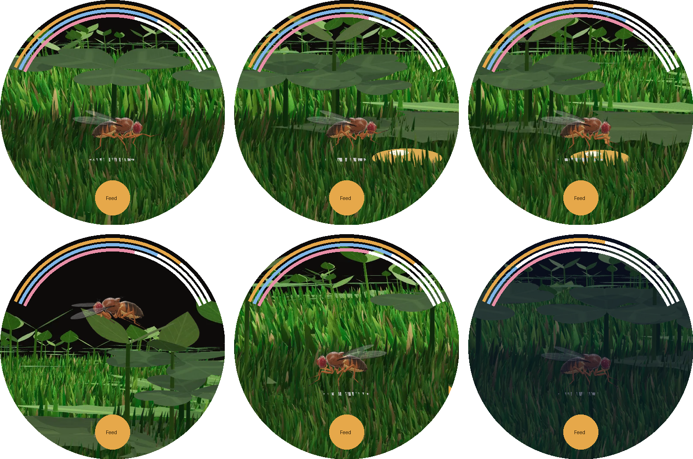

# Feed the Fly

A Tamagotchi-style pet for **Wear OS** watches (built for the Samsung Galaxy Watch Ultra),
using the same fly and neuron model as the rest of this repository. Your fly lives on your
wrist: it gets hungry, sleeps at night, and decides for itself, with real connectome
wiring, whether to eat what you give it and whether to flee when you poke at it.



The fly lives in the same grass arena as the website: the GPU grass, clover, dandelions and
seedlings with their detailed skins (web/src/terrain.js), rendered at the fly sprites' scale and
viewing angle into three layers (`tools/scenery.html`): the plants just behind the fly's path,
the grass in front of it (drawn over its feet), and a far view to the arena's edge that
scrolls with parallax, under the website's daylight sky and clouds. The view follows the fly
and rises when it flies. The fly buzzes in flight (a synthesized ~210 Hz wingbeat) and rubs
softly while it grooms; switch sound off in the info panel.

These previews are composed on a computer from the game's own assets with the app's placement
rules (`tools/compose_preview.py`). They are not captures from a watch.

## Playing

- **Feed** drops sugar just ahead of the fly (tapping the ground drops it there; an arrow at
  the edge points to sugar off screen). The fly walks over, and when its feet touch
  the drop its sugar-sensing taste neurons fire. If the proboscis motor neuron **MN9**
  responds, the proboscis comes out and the fly drinks. A full fly often doesn't respond:
  it says "Not hungry" and walks off.
- **Tap the fly** and a hand looms in from that side. Its looming detectors (LC4, LPLC2)
  drive the **Giant Fiber**; if that crosses threshold, the fly takes off. Chasing it
  around too often upsets it.
- **Long-press the fly** to tickle its head. Its head bristles drive the **DNg12** grooming
  neurons; if they fire, it stops and cleans itself: front-leg sweeps over the eyes
  alternating with leg rubbing. It also grooms after meals (sugar on its face) and now and then
  when dust settles on it, whenever the circuit decides to.
- **Food, energy and mood** are the three arcs at the top of the face. Food drains over
  about 12 hours, energy while it's awake, and it sleeps from 22:00 to 07:00 (sleeping
  flies are harder to startle). If food runs out, the fly lies still until you feed it.
- **Droppings:** what it drinks passes through its gut and, a minute or so later, the fly
  stops, dips the tip of its abdomen and leaves a tiny brown droplet behind it (a meal
  eaten before you closed the game is waiting on the stage when you come back). Uncleaned
  droppings slowly sour its mood: tap the brown chip left of **Feed** to clean them up.
- **i** opens stats, live neuron rates and credits.

## What's real and what isn't

- **Brain:** the watch runs a **16,540-neuron, 2.5-million-connection subcircuit** of the
  MaleCNS v1.0 connectome: every neuron on a strong path of up to 4 synapses from the
  game's senses (taste, looming) to its behaviors (MN9, Giant Fiber, P9, MDN, DNa01/02),
  plus every connection among them. It uses the same neuron model as the website (Shiu et al.
  2024 plus short-term depression and spike-frequency adaptation). [VALIDATION.md](VALIDATION.md)
  compares it with the full 165k-neuron brain: looming → Giant Fiber 227 vs 227 Hz, taste →
  MN9 14 vs 16 Hz. The website's spontaneous background activity and motor-neuron readout
  are not in the watch game: this circuit holds only the neurons between the game's senses
  and its behaviors, so there is no sensory background or leg/wing motor pool to drive.
  Odor responses differ, so the game has no odor lures.
- **Hunger:** starvation makes sugar-sensing neurons more sensitive (Inagaki et al. 2012),
  so a hungry fly recruits more of them (up to 40 of 72) when it touches food. Whether
  that set drives MN9 past threshold is decided by the circuit: with 1–4 neurons it
  rarely does, with 12 or more it almost always does. In tests a full fly fed in 0 of 6
  trials and a starving fly in 6 of 6.
- **Hand-set:** walking toward food, wandering, the sleep schedule, stat decay rates,
  and how fast it drinks are game rules, not neural.
- **Fly:** frames are pre-rendered from the FlyBody 3D model (`tools/sprites.html`) with
  recorded NeuroMechFly leg kinematics, so it looks like the website's fly at little
  battery cost.

## Installing on your watch

Every push that changes `watch/` builds the app on GitHub Actions
(`.github/workflows/watch-apk.yml`). Open the latest run of **Feed the Fly (Wear OS and
phone APKs)** in the repository's **Actions** tab and download the `feed-the-fly-apk`
artifact (a zip with `feed-the-fly-watch.apk`).

Wear OS apps that aren't on the Play Store are installed with `adb`
([Android platform tools](https://developer.android.com/tools/releases/platform-tools)):

1. On the watch: **Settings → About watch → Software information**, tap **Software
   version** 5 times to enable Developer options.
2. **Settings → Developer options**: turn on **ADB debugging** and **Wireless debugging**.
   Put the watch and computer on the same Wi-Fi.
3. In Wireless debugging, tap **Pair new device** and run, with the shown address and code:
   `adb pair <ip>:<pair-port>` then `adb connect <ip>:<port>` (the port on the main
   Wireless debugging screen).
4. `adb install -r feed-the-fly-watch.apk`, then open **Feed the Fly** from the app list.

Phone apps that wrap `adb` (for example Bugjaeger on Android) can do the same without a
computer. The APK is signed with a public sideload key (`sideload.keystore`), so newer
builds install over older ones and keep your pet. It is not suitable for Play Store release.

## On your phone

`phone/` is Feed the Fly for Android phones (Android 8 or newer, portrait; made for tall
screens like the Galaxy S23 Ultra). It is the website's game mode (`web/index.html?game`)
full screen: the same 3D fly, grass arena, sky, sounds and whole 165,122-neuron brain as on
the website, not the watch's 2D sprites. The site, connectome and three.js are packed into
the APK and served to the app's WebView by a small web server on 127.0.0.1, so it works
offline and never downloads the connectome (the APK is about 52 MB). The pet (food, energy,
mood, droppings) is saved by the page and keeps living while the app is closed; the
phone's fly is its own pet, separate from the watch's. Feed, Tickle, Clean and Lab (the
website's science panels) are along the bottom.

The Kotlin whole-CNS mode (`GameEngine(fullBrain = true)`, `FlyWorld.smart`) stays in
`:brain` and is still tested (`FullBrainTest`), but the phone app no longer uses it.

To install it, download the `feed-the-fly-phone-apk` artifact from the same Actions run,
unzip it on the phone, and open `feed-the-fly-phone.apk`. Android asks once to allow
installs from that app (Files or your browser): allow it, then tap **Install**.

## Building and rebuilding assets

```bash
cd watch
./gradlew :brain:test                       # brain + game logic tests (no Android SDK needed)
./gradlew :app:assembleRelease              # watch APK (needs the Android SDK)
./gradlew :phone:assembleRelease            # phone APK
# Rebuild the circuit and validation report (from the repo root):
PYTHONPATH=. python watch/tools/export_brain.py
# Re-render the fly frames:
cd watch/tools && npm install three@0.169.0 playwright && node render_sprites.mjs && python sprites_to_webp.py
```

`:brain` is plain Kotlin (engine in `brain/src/main/kotlin/fly/brain`, game in
`fly/game`), tested on the JVM. `:app` is the Wear OS Compose UI and `common/` its engine
thread, sound and scene drawing. `:phone` is a WebView shell; its build copies `web/` into the
APK.

## Credits

Brain: MaleCNS v1.0 connectome (Janelia FlyEM, Google Research, Cambridge Connectomics
Group / MRC LMB and consortium; CC-BY 4.0) and the neuron model of Shiu, Sterne *et al.*,
*Nature* 2024. Fly: FlyBody (Vaxenburg, Siwanowicz *et al.*, *Nature* 2025; Apache-2.0),
rigged with NeuroMechFly / flygym (Ramdya lab, EPFL; Apache-2.0). Hunger and sugar
sensitivity: Inagaki *et al.*, *Neuron* 2012. Full citations: [../CREDITS.md](../CREDITS.md).
